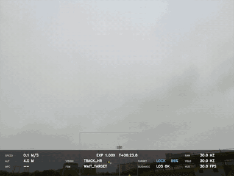
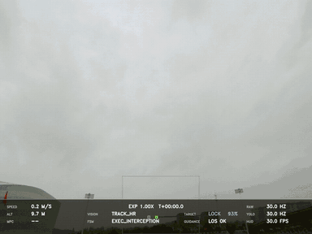
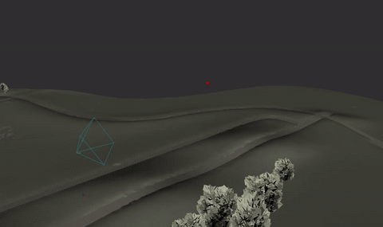
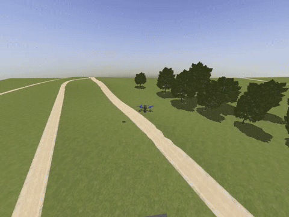
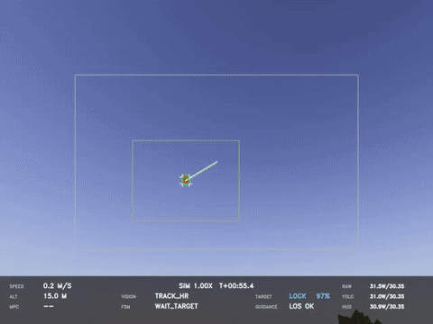
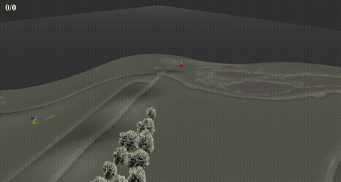
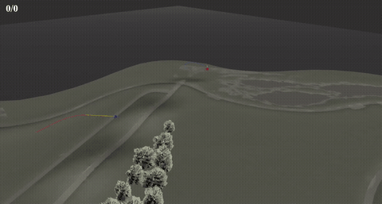
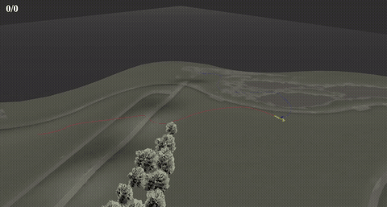
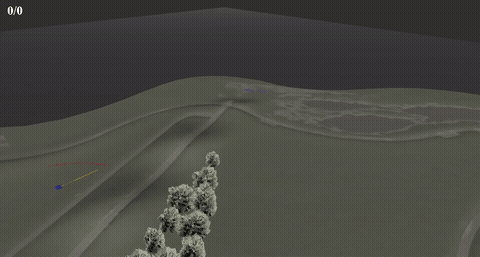

<h1 align="center">ISB-NMPC</h1>
<p align="center"><strong>Interception-Oriented Spherical-Bearing Nonlinear Model Predictive Control for Quadrotors</strong></p>

<p align="center">
  <a href="https://arxiv.org/abs/2610.34789"></a>
  <a href="LICENSE"></a>
  
  
</p>

<p align="center">
  <a href="#demonstrations">Demonstrations</a> ·
  <a href="#hardware-and-related-repositories">Hardware</a> ·
  <a href="#build">Build</a> ·
  <a href="#run">Run</a> ·
  <a href="#citation">Citation</a>
</p>

A ROS 1 workspace for monocular vision-driven quadrotor interception.
**ISB-NMPC** directly optimizes interception control on SO(3), while **DC-S2EKF**
compensates for detection latency and guides ROI-based small-target detection.

**Paper:** [arXiv preprint arXiv:2610.34789](https://arxiv.org/abs/2610.34789).
The accompanying [Holydrone hardware](https://github.com/HOLYNOTBAD/holydrone)
is the 7-inch quadrotor platform used in the paper and experiments;
[holydrone_ros](https://github.com/HOLYNOTBAD/holydrone_ros) provides its ROS and Gazebo integration.

> [!NOTE]
> I hope this work will be useful to the community, and I warmly welcome your
> feedback and further development as we work together toward a peaceful and safe
> low-altitude environment ^_^. Feel free to contact me at
> [hongli@buaa.edu.cn](mailto:hongli@buaa.edu.cn).
>
> By the way, if you use any content from this repository, please cite
> [my paper](#citation). I would also greatly appreciate it if you could give this
> repository and the related projects a star!

## Demonstrations

Four operating modes cover real flight, single-run simulation, repeated trials,
and controller comparison. **Click any preview to open the MP4 video.**

| Mode | Entry point | Demonstration |
| :--- | :--- | :--- |
| Real flight | [interception_real.sh](_scripts/run/interception_real.sh) | Onboard and external views |
| Simulation | [interception_sim.sh](_scripts/run/interception_sim.sh) | RViz, Gazebo third-person, and FPV views |
| Loop simulation | [interception_loopsim.sh](_scripts/run/interception_loopsim.sh) | Shares the comparison showcase below |
| Loop comparison | [interception_loopcomparison.sh](_scripts/run/interception_loopcomparison.sh) | Four controllers compared |

### Real flight

The software and accompanying hardware resources support the interception scenarios shown below.

| Long-range interception · Onboard | Maneuvering target tracking · Onboard |
| :---: | :---: |
| [](docs/media/long-range-fpv.mp4) | [](docs/media/maneuvering-fpv.mp4) |

Additional views: [Long-range overhead](docs/media/long-range-overhead.mp4) ·
[Maneuvering target external view](docs/media/maneuvering-external.mp4).

### Simulation

| RViz | Gazebo · Third-person | Gazebo · FPV |
| :---: | :---: | :---: |
| [](docs/media/simulation-rviz.mp4) | [](docs/media/simulation-gazebo.mp4) | [](docs/media/simulation-fpv-debug.mp4) |

### Loop simulation and controller comparison

- **Loop simulation** runs the YOLO/EKF perception loop for repeated evaluation of a controller.
- **Loop comparison** synthesizes observations from Gazebo ground truth to compare controller performance.

| ISB-NMPC | Backstepping |
| :---: | :---: |
| [](docs/media/comparison-isb-nmpc.mp4) | [](docs/media/comparison-backstepping.mp4) |
| **PS-LOS** | **IBVS-LOS** |
| [](docs/media/comparison-pslos.mp4) | [](docs/media/comparison-ibvs-los.mp4) |

## Hardware and related repositories

Hardware, aircraft integration, and interception algorithms are maintained separately.

| Repository | Role |
| :--- | :--- |
| [holydrone](https://github.com/HOLYNOTBAD/holydrone) | Holydrone quadrotor hardware and platform documentation |
| [holydrone_ros](https://github.com/HOLYNOTBAD/holydrone_ros) | Gazebo models, Baylands terrain, PX4 SITL and MAVROS launch files, and camera-model synchronization |
| **ISB-NMPC** · This repository | Perception, delay compensation, interception control, task state machines, and repeated-trial orchestration |

After cloning or updating submodules, download the aircraft model assets through Git LFS:

```bash
git submodule update --init --recursive
git -C src/holydrone_ros lfs pull
```

## Build

| Component | Environment |
| :--- | :--- |
| OS and middleware | Ubuntu 20.04 · ROS Noetic |
| Simulation | Gazebo Classic 11 · PX4 v1.16.2 · MAVROS |
| Libraries | Eigen · OpenCV · CUDA / TensorRT |
| YOLO backends | RTX 5080 and Orin NX, selected at build time |

Other GPUs require adapting the inference backend and CUDA architecture settings.

### 1. Build the ROS workspace


Run from the repository root with ROS, CUDA / TensorRT, and Git LFS installed:

```bash
source /opt/ros/noetic/setup.bash
# Initialize submodules and download LFS assets
git submodule update --init --recursive
git lfs pull
git -C src/holydrone_ros lfs pull
rosdep install --from-paths src --ignore-src -r -y
catkin_make -DCMAKE_BUILD_TYPE=Release -j6
source devel/setup.bash

# Build the detection engine on the target GPU; generated ACADO solvers are included
src/yolo/weights/_scripts/make_engine.sh \
  src/yolo/weights/weights/best_640x480.wts \
  src/yolo/weights/balloon.engine n 640 480
```

Build TensorRT engines on the target device. To use the output above, set
`export TARGET_DETECTION_YOLO_ENGINE_FILE="$PWD/src/yolo/weights/balloon.engine"` before launching.

### 2. Install PX4 and register the Holydrone airframe

The validated simulation stack uses **PX4 v1.16.2 + Gazebo Classic 11**; see the
[version snapshot](src/holydrone_ros/px4/VERSION.md). The commands below install PX4
to `~/PX4-Autopilot`. If this version is already installed, skip cloning and set
`PX4_DIR` to its actual location.

```bash
export PX4_DIR="$HOME/PX4-Autopilot"
git clone --recursive --branch v1.16.2 \
  https://github.com/PX4/PX4-Autopilot.git "$PX4_DIR"
bash "$PX4_DIR/Tools/setup/ubuntu.sh"
```

Reboot or log in again if requested by the installer. Open a new terminal, return
to this repository root, and run:

```bash
source /opt/ros/noetic/setup.bash
source devel/setup.bash
export PX4_DIR="$HOME/PX4-Autopilot"
HOLYDRONE_DIR="$(rospack find holydrone)"
PX4_AIRFRAMES="$PX4_DIR/ROMFS/px4fmu_common/init.d-posix/airframes"

# Copy the airframe startup configuration
install -m 0755 \
  "$HOLYDRONE_DIR/px4/overlay/ROMFS/px4fmu_common/init.d-posix/airframes/22000_gazebo-classic_holydrone" \
  "$PX4_AIRFRAMES/22000_gazebo-classic_holydrone"

# Register in ROMFS; migrate the legacy name without adding duplicate entries
sed -i 's/22000_gazebo-classic_holydrone_cam/22000_gazebo-classic_holydrone/g' \
  "$PX4_AIRFRAMES/CMakeLists.txt"
if ! grep -q '22000_gazebo-classic_holydrone' "$PX4_AIRFRAMES/CMakeLists.txt"; then
  sed -i '/71001_gazebo-classic_spacecraft_dart/i\        22000_gazebo-classic_holydrone' \
    "$PX4_AIRFRAMES/CMakeLists.txt"
fi
grep -n '22000_gazebo-classic_holydrone' "$PX4_AIRFRAMES/CMakeLists.txt"
```

The final command should show exactly one airframe entry. Gazebo models and the
Baylands terrain are supplied by `src/holydrone_ros`; they do not need to be copied
into PX4. The earlier LFS download retrieves their meshes and textures.

### 3. Build and verify PX4 SITL

```bash
git -C "$PX4_DIR" submodule update --init --recursive
make -C "$PX4_DIR" px4_sitl_default
DONT_RUN=1 make -C "$PX4_DIR" px4_sitl gazebo-classic

# Check the flight controller binary, airframe, and key simulation plugins
PX4_BUILD_DIR="$PX4_DIR/build/px4_sitl_default"
test -x "$PX4_BUILD_DIR/bin/px4" && \
  test -f "$PX4_BUILD_DIR/etc/init.d-posix/airframes/22000_gazebo-classic_holydrone" && \
  test -f "$PX4_BUILD_DIR/build_gazebo-classic/libgazebo_mavlink_interface.so" && \
  test -f "$PX4_BUILD_DIR/build_gazebo-classic/libgazebo_motor_model.so" && \
  echo "PX4 SITL build checks passed"
```

The second `make` command builds the Gazebo Classic plugins; `DONT_RUN=1` prevents
automatic simulation startup. Run both build commands again after changing the
airframe configuration. At runtime, `sitl.launch` sets the model and plugin paths;
keep `PX4_DIR` pointed at the PX4 directory above.

## Run

Run from the workspace root. Set `PX4_DIR` to your local PX4 installation before simulation.

```bash
export PX4_DIR=/path/to/PX4-Autopilot

# Single-run simulation
./_scripts/run/interception_sim.sh

# Repeated simulation trials
LOOP_COUNT=10 ENABLE_LOOP_RESULTS=1 ./_scripts/run/interception_loopsim.sh

# Controller comparison: 10 trials per method
LOOP_COUNT=10 ./_scripts/run/interception_loopcomparison.sh

# Real flight: configure the positioning source, serial port, and system ID
POS_SOURCE=gps MAVROS_FCU_URL=/dev/ttyTHS0:2000000 MAVROS_TGT_SYSTEM=2 \
  ./_scripts/run/interception_real.sh

# Stop the entire stack
./_scripts/run/kill.sh
```

Select camera calibration through `CAMERA_PARAM_FILE` in each launch script.
Other parameters are maintained in the corresponding ROS package's `config/` directory.

> **Real flight:** The default workflow is manual takeoff followed by OFFBOARD takeover.
> Review the [real-flight FSM configuration](src/plan_manage/config/interception_real_fsm.yaml)
> and device settings before operation.

## Repository guide

| Path | Purpose |
| :--- | :--- |
| [src/isb_nmpc](src/isb_nmpc) | Controller, ACADO models, and generated solvers |
| [src/dc_s2ekf](src/dc_s2ekf) | Bearing filtering, delay compensation, and ROI prediction |
| [src/plan_manage](src/plan_manage) | Interception state machine and PX4 interface |
| Each package's `config/` directory | Package-owned node parameters |
| [src/interception_visualization](src/interception_visualization) | RViz configuration and interception visualization |
| [src/loop_simulation](src/loop_simulation) | Repeated-trial orchestration and result summaries |
| [src/loop_comparison](src/loop_comparison) | Ground-truth-driven controller comparison with shared seeds |
| [src/interception_baseline](src/interception_baseline) | Backstepping, PSLOS, and high-speed turning-attack baselines |
| [interception_sim.sh](_scripts/run/interception_sim.sh) | Single-run Gazebo interception |
| [interception_real.sh](_scripts/run/interception_real.sh) | Real-flight deployment |
| [interception_loopsim.sh](_scripts/run/interception_loopsim.sh) | Repeated interception trials |
| [interception_loopcomparison.sh](_scripts/run/interception_loopcomparison.sh) | Multi-controller comparison |
| [src/debug](src/debug) | Replay and experiment analysis |

## License

Original project code is licensed under the **GNU General Public License v3.0
(GPL-3.0-only)**; see [LICENSE](LICENSE). Commercial use is permitted. Distribution
of covered programs or modified versions must comply with the corresponding
source-code, copyright-notice, and license obligations.

Third-party code and files with separate license notices retain their existing terms.
The `holydrone_ros` submodule is licensed separately by its repository. Models,
textures, weights, videos, and the paper are not automatically licensed under GPL
by the top-level software license. See [THIRD_PARTY.md](THIRD_PARTY.md) for identified
notices and items requiring further verification.

## Citation

```bibtex
@article{hong2026isbnmpc,
  title={ISB-NMPC: Interception-Oriented Spherical-Bearing Nonlinear Model Predictive Control for Quadrotors},
  author={Hong, Li and Liu, Linkai and Ren, Xiangyu and Lv, Shuli and Min, Chen and Wu, Chunjiang and Zhang, Yujun and Zeng, Dingchen and Quan, Quan},
  journal={arXiv preprint arXiv:2610.34789},
  year={2026},
  doi={10.48550/arXiv.2610.34789},
  url={https://arxiv.org/abs/2610.34789}
}
```

## Acknowledgements

Special thanks to the authors and contributors of the following open-source projects
for the research references and tools that supported this work:

- [PAMPC / rpg_mpc](https://github.com/uzh-rpg/rpg_mpc)
- [EGO-Planner](https://github.com/ZJU-FAST-Lab/ego-planner)
- [Fast-Planner](https://github.com/HKUST-Aerial-Robotics/Fast-Planner)
- [FSC-Lab / fsc_aggressive_ibvs](https://github.com/FSC-Lab/fsc_aggressive_ibvs)
- [ACADO Toolkit](https://github.com/acado/acado)
- [YOLOv5](https://github.com/ultralytics/yolov5)
